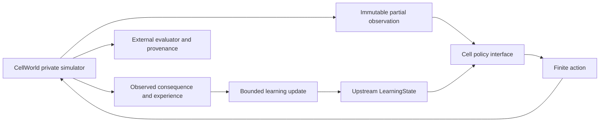

# Architecture

CellWorld owns world generation, transitions, energy and termination. Its private state
and snapshot API belong to the driver/evaluator, never to the policy. Isolation is an
interface convention in one Python process, not a security sandbox against malicious code.
A policy gets Observation and later Experience, never a world reference or seed.
Action is an explicit seven-member enum; invalid values fail before state mutation.

The Cell runner coordinates observations, actions and optional feedback updates. It
accepts any typed Policy, so controls share the same environment contract. It logs each
observed experience through a callback without supplying hidden maps to the learner.
Episode metrics are outside the policy. Internal state is owned by a persistent policy
and, for the neural pilot, upstream LearningState.external; no duplicate state owner.

The experimental adapter encodes local observations plus a candidate action, invokes
MiniGPT logits and predicts energy-delta categories. Expected immediate energy change
provides action preferences with fixed stochastic exploration. One CE objective updates
from the selected action's observed outcome. No planner, resource map or action labels
are supplied. This myopic hypothesis may fail long-horizon viability.

LearningState owns the upstream model, optimizer, scheduler, RNG snapshot and declared
external graph. Policy RNG, bounded experience history, driver world snapshots and update
counters live there. An immutable parent checkpoint hash links each final checkpoint.
Trusted pickle checkpoints require exact code/runtime and cannot be accepted from unknown
sources. Episode boundaries preserve the same owner within each arm. Evaluation freezes
updates; it must not become a source of training choices.

Snapshot continuation of CellWorld is locally tested. Full learner fresh-process
continuation is an outstanding remote admission gate. Arbitrary cross-version topology
migration is unsupported. Future multi-cell work must define shared versus private state,
communication observations/actions, costs and credit assignment, with no hidden hard-coded
roles and a capacity-matched single-cell control. None is implemented at L.0.
