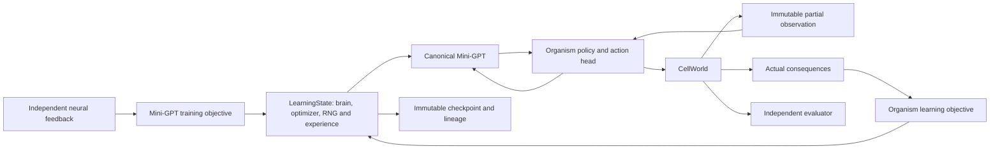

# Unified architecture

## Ownership

mini_gpt/model owns configurable embeddings, causal SDPA, position encodings, dense
blocks, one hidden_states traversal and token logits. mini_gpt/learning owns AdamW
parameter grouping, finite gradient updates, LearningState and independent token training.
mini_gpt/checkpoint owns exact comparison/file identity and explicit trusted historical
conversion. One full-state serialization implementation lives on LearningState.
No imports from organism code are needed by the neural engine.

Ontogeny owns CellWorld, observations/actions, the organism-specific linear action head,
REINFORCE objective, experience records and world/episode driver. Environment feedback
is actual energy/action/resource/hazard consequence; no heuristic labels or planner enter
the neural learner. PolicyCell retains the same seven-action sampling and objective as
before consolidation. The obsolete unexecuted consequence-prediction pilot is archived
at the pre-migration Git revision rather than maintained as another active learning path.

The common execution worker translates validated input artifacts to a bounded task;
Kaggle and Colab own transport, resource admission, export and cleanup. They do not
implement different neural engines. Schema2 source identity is the single Ontogeny SHA
plus engine name. Historical schema1 is an artifact-reading contract, not a new worker
compatibility promise. Explicit import checks prevent an unrelated package shadowing the
engine under the verified source tree.

## Interaction and state

A policy receives immutable Observation, then Experience with observed action consequence.
It cannot receive simulator seeds, full resource maps, future transitions or heuristic
choices. Private simulator snapshots are driver/checkpoint/evaluator data. This is a
trusted interface boundary within Python, not a sandbox for adversarial source code.

LearningState owns model, optimizer, optional scheduler, metadata and a declared external
graph. Organism state there includes policy RNG, experience/baseline/history, episode
cursor, world snapshot and current observation. Research students use their own streams,
progress and memory. Episode resets preserve the owner. All Python/NumPy/Torch CPU/CUDA
RNGs, gradients, flags and model/optimizer/external aliases survive supported full-state
restore. Rejected transactions roll back owned state; arbitrary external effects do not.

Independent research (A) and organism development (B) use this same code with distinct
LearningState instances. Controlled consolidation (C) is future research: it must retain
prior competence and account for rehearsal/distillation/validation work. Copying a newer
research checkpoint over an organism is not consolidation and is not implemented.

## Persistence and evaluation

Snapshots are immutable, atomic, fsynced trusted full objects; schema version and source
lineage are explicit. Format2 uses mini_gpt class paths. Dense format1 import requires
explicit trust/hash/revision and has a narrow class map; unsupported old students stay
with original code. No silent partial state_dict loading, optimizer reset or new parameter
initialization is allowed while claiming continuity. See MIGRATION.md for actual gates.

Evaluation is outside the learner, uses separate worlds/RNG boundaries, performs no
updates and restores the full learner afterward. Policy reward, prediction fit and
independent scientific competence are distinct measurements. Existing L.1 FAIL is
unchanged. Later cooperative cells would require explicit communication/cost/state/credit
contracts and capacity-matched controls. No cooperation or speculative growth module is
created during consolidation. Architecture settings remain revisable hypotheses with
finite experiment limits, not permanent definitions of intelligence.
