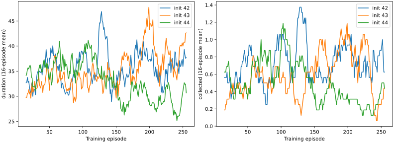
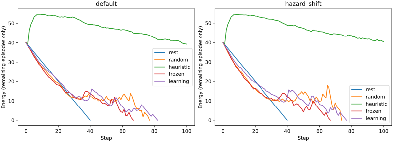

# L.1 qualification — preregistration and execution record

**Actual verdict: L.1 Learning FAIL.** H1 FAIL, H2 FAIL, H3 PASS. Neural updates,
source integration and full-state persistence work; reliable behavioral improvement
through experience is not established. No checkpoint promoted; L.2 is not authorized.

## Measured results

768 training episodes, 26,618 training interactions and 768 scientific optimizer updates
across three initializations. 2,400 independent evaluation episodes (1,920 sealed plus
480 development), five policies, two variants. All outcomes retained; none selected
for reporting. Checkpoint records, uncertainty, curves and raw artifact references:
[qualification](../experiments/l1_single_cell/results/qualification.json),
[comparisons](../experiments/l1_single_cell/results/comparison.csv),
[continuation](../experiments/l1_single_cell/results/continuation.json).

Each table row aggregates 192 sealed episodes: 64 worlds × 3 initializations.
Resource efficiency is the mean episode collection/action, not a reward score.

| Variant | Policy | Steps | Resources | Hazard encounters | Resources/action | Horizon % |
|---|---|---:|---:|---:|---:|---:|
| default | rest | 40.00 | 0.000 | 0.000 | 0.00000 | 0.00 |
| default | random | 32.36 | 0.547 | 2.005 | 0.01219 | 0.00 |
| default | heuristic | 98.53 | 12.672 | 0.000 | 0.12747 | 90.10 |
| default | frozen | 30.59 | 0.469 | 2.229 | 0.01125 | 0.00 |
| default | learning | 35.73 | 0.453 | 1.417 | 0.00991 | 0.00 |
| hazard_shift | rest | 40.00 | 0.000 | 0.000 | 0.00000 | 0.00 |
| hazard_shift | random | 26.98 | 0.432 | 2.844 | 0.01171 | 0.00 |
| hazard_shift | heuristic | 97.94 | 12.490 | 0.000 | 0.12582 | 89.58 |
| hazard_shift | frozen | 27.50 | 0.427 | 2.719 | 0.01123 | 0.00 |
| hazard_shift | learning | 34.16 | 0.432 | 1.693 | 0.00872 | 0.00 |

The trained policy's cohort mean is below rest-only duration (40) in both variants,
and far below the fixed heuristic. Every neural/random/rest episode exhausts energy;
only the heuristic reaches the horizon (~90%). No behavioral learning PASS is inferred
from a smaller hazard count or positive mean duration alone.

| Initialization | First 64 steps | Last 64 steps | First 64 resources | Last 64 resources |
|---|---:|---:|---:|---:|
| 42 | 34.797 | 35.891 | 0.625 | 0.734 |
| 43 | 32.609 | 38.875 | 0.406 | 0.594 |
| 44 | 35.469 | 28.906 | 0.547 | 0.266 |

H1 FAIL: all three models changed and all applied genuine gradients, but 44 regressed.
H2 FAIL: no preregistered lower confidence bound exceeds zero. Default duration
learning-minus-random +3.370 [−15.045, +21.785], learning-minus-frozen +5.141
[−7.091, +17.372]. Default collection differences are −0.094 and −0.016 respectively.
Hazard-shift duration differences +7.182 [−12.154,+26.518] and +6.661
[−11.781,+25.104]; collection differences 0.000 and +0.005. Resource efficiency is
lower than both neural/random controls in both variants. Intervals use three
initialization means; the wide uncertainty is a practical limitation, not a pass.
H3 PASS: full checkpoint reload, next distribution/action/transition and neural update
match exactly in fresh processes, including the trained students' complete optimizer,
gradients, buffers, counters and RNG. This is same-code/runtime T4 evidence only.





Energy curves average only episodes still present at that step; late-step fluctuations
are survivor-conditioned and must not be read as whole-cohort energy improvement.
SVG and PNG exports were rendered and visually checked. These curves show all three
training initializations; no favorable checkpoint selection or smoothing-based gating.

## Reproduction and provenance

Scientific training source: `adb97ff0ccd102b9f617922b4a1b6eefce8c9a91`.
Recovery source: `6a0cf716b53b2f5cf9ebd4f3ea161a1e786203c0`.
Upstream: `8567836fb2c8c915d442b7c2fbedb4fd9b30396d` (unchanged).
Kaggle CUDA T4, Torch 2.6.0+cu124, CUDA 12.4, Python 3.13.15, NumPy 2.1.3.
Two T4 devices allocated by Kaggle, one used. Main neural execution 193.175 s;
recovery 36.983 s, excluding image/package setup and artifact transfer. CUDA-kernel
active time was not separately profiled; these are execution wall times on GPU jobs.
Raw pip freeze and installation/conflict warnings remain in runtime/log artifacts.

Each student has 118,023 parameters, including 1,799 in the new action head.
Each initialization applied 256 training updates on 9,162 / 9,031 / 8,425 examples.
Inference during training used the same respective counts. Gradient forward/backward
processes each episode batch additionally; this is not compute-matched to frozen inference.
Admission and discarded continuation-audit updates are additional, separately recorded
costs, not scientific training. No audit checkpoint was substituted for a final model.
Including failed/admission/audit copies, 7 extra optimizer updates occurred, for 775
actual optimizer updates across all jobs; only the original 768 train the evaluated
models. The failed 44 audit had already applied its discarded update before the harness
stepped the ended world. The records-only extraction applied zero new updates.
Evaluation used 111,316 interactions and 1,089,140 sensed tiles; training used 287,242
sensed tiles. Detailed accounting and file hashes are in results/audit.json (PASS).

Completed kernels (all version 1 except successful smoke version 2):

- [Smoke](https://www.kaggle.com/code/sparklinghydraulics0/ontogeny-l1-smoke): v1 failed comparator, v2 COMPLETE/PASS.
- [Original training](https://www.kaggle.com/code/sparklinghydraulics0/ontogeny-l1-experiment): ERROR at final audit; full trained states preserved.
- [Input-less recovery](https://www.kaggle.com/code/sparklinghydraulics0/ontogeny-l1-recovery): ERROR, missing mount; no training.
- [Verified recovery](https://www.kaggle.com/code/sparklinghydraulics0/ontogeny-l1-recovery-verified): COMPLETE; fixed audit and missing evaluation only.
- [Records extraction](https://www.kaggle.com/code/sparklinghydraulics0/ontogeny-l1-records-verified): extraction-only artifact audit; final status recorded below.

Raw original bundle: runs/l1-experiment-v1/output/l1-experiment.
Raw completed bundle: runs/l1-recovery-verified/output/l1-recovery.
Immutable private input version 1 and archive/file hashes: experiment-v1/recovery-input.json
and artifacts.json under experiments/l1_single_cell. Binary checkpoints and full raw
histories remain out of Git; small measured summaries, negative traces and curves are tracked.

```bash
# From the final report checkout, prepare the historical published source.
uv run python kaggle/prepare.py --revision adb97ff0ccd102b9f617922b4a1b6eefce8c9a91 --mode experiment --job runs/reproduce-l1/job
kaggle kernels push -p runs/reproduce-l1/job --accelerator NvidiaTeslaT4 -t 4200
# This faithfully reproduces the original audit-fixture failure. To complete its
# exact preserved models, use the immutable input recovery source and dataset:
uv run python kaggle/prepare.py --revision 6a0cf716b53b2f5cf9ebd4f3ea161a1e786203c0 --mode recovery --job runs/reproduce-recovery/job
kaggle kernels push -p runs/reproduce-recovery/job --accelerator NvidiaTeslaT4 -t 4200
kaggle kernels output sparklinghydraulics0/ontogeny-l1-recovery-verified/1 -p runs/reproduced-output
# Final checkout can also run a new complete trial with the safe audit fixture.
# That is a new recorded run, not a replacement of these historical outcomes.

# Non-neural analysis of downloaded records (no checkpoint loading locally):
uv run --with matplotlib==3.10.1 python scripts/report_l1.py runs/l1-recovery-verified/output/l1-recovery runs/new-analysis
uv run python scripts/audit_l1.py runs/l1-recovery-verified/output/l1-recovery runs/new-audit.json
```

Records-only output supplies the missing 44-gradients.json sidecar. Download and place
it alongside the recovered bundle before running the full auditor:

```bash
kaggle kernels output sparklinghydraulics0/ontogeny-l1-records-verified/1 -p runs/l1-records/output
cp runs/l1-records/output/l1-records/44-gradients.json runs/l1-recovery-verified/output/l1-recovery/44-gradients.json
```

The records job source is 7f4ba6dc817f2fe2a3bd8fb6f6156c41e689dbb8; prepare it with
`--mode records` at that revision if re-extraction is needed. Use new output directories to
preserve prior runs. Kaggle mounts require the owner's private dataset access.

**Next decision:** stay at L.1. Diagnose instability using training/development records,
then preregister any new single-mechanism trial with fresh sealed worlds. Do not tune
against this sealed cohort or start L.2, architecture growth or a second cell.

## Preregistered protocol and chronological evidence


Protocol **l1-reinforce-v1**, frozen before neural execution. Starting Ontogeny
b0caa6e91d6a2ec44f7b27d3f9a83be5a1524648; upstream unchanged at
8567836fb2c8c915d442b7c2fbedb4fd9b30396d. The execution commit is recorded by the
launcher and runtime.json. No historical checkpoint knowledge is claimed.

## Method and integration

The unexecuted immediate-consequence-v1 proposal remains historical, superseded here
before any results. This is one REINFORCE objective, no world-model auxiliary objective,
no replay training, entropy bonus, planner, expert targets, growth or extra cell.
Model: actual upstream MiniGPT, 2 layers, width 64, 4 heads, FFN 128, context/vocabulary
256, dropout 0. A freshly initialized Linear(256,7) head reads its final-token logits.
This uses the verified forward interface without copying a Transformer or mistaking
language logits for a qualified policy. All backbone and head parameters train.

Encoding is fixed 29 tokens: 5x5 relative tiles, unobserved cells masked to token zero,
radius, energy, consequence and constant readout token. Normal sensing remains 3x3;
inspection reveals 5x5. No global coordinates, seed, full map, future state, heuristic
action or evaluator labels enter the policy. All 7 actions remain legal: no privileged
wall/resource mask. Invalid output shape/nonfinite probabilities fail closed.

Actions sample softmax with an owned Python RNG. After each episode, discounted actual
energy_delta/15 returns (gamma .97) minus an owned timestep-wise EMA baseline (.9 decay)
weight the chosen action log probabilities. One mean policy-gradient objective, AdamW
lr .0005, no weight decay, gradient clipping 1.0. Nonfinite or absent backbone/head
gradients abort. Baseline is updated after the gradient step, never with evaluator data.

## Frozen benchmark, controls and budget

CellWorld v1 dynamics and all L.0 files are unchanged. Initial benchmark is defaults.
Held-out variation changes hazards 12->18 and relocation interval 20->10, leaving resource
count and sensing intact. It is harder but the original heuristic remains feasible.

3 initializations: 42,43,44. Training worlds 10000..10255, one encounter each per init;
256 updates maximum, <=25,600 interactions per init. Development 20000..20015; sealed
30000..30063. Both evaluated under default and hazard_shift. Control action RNG is
model_seed*100000+world_seed and matched between frozen and trained policies. Policies
get neither number. Five arms: rest, random, heuristic, frozen initial neural, final
trained neural. 2,400 total evaluation episodes (3*5*2*80). Final checkpoint is always
update 256, never selected on evaluation. All dev and sealed outcomes are collected
without tuning or checkpoint choice. No later stages begin automatically.

One smoke job then one experiment job, each hard subprocess timeout 4200 s; experiment
cooperative cap 3600 s. No CPU fallback. GPU T4 requested. Torch 2.6.0+cu124, NumPy 2.1.3,
PyYAML 6.0.2, pytest 8.3.5 pinned; Python/CUDA/driver/GPU and full pip freeze captured.
Actual Kaggle runtime is recorded rather than assumed cross-image reproducible.

Store every observed training transition; each checkpoint retains pending experience
(up to 100), previous episode, EMA baseline, update/forward/gradient counters, model,
optimizer, gradients, global and policy RNG and driver world/RNG/last observation.
Full files are immutable upstream LearningState trusted same-code checkpoints.
Snapshots are privileged driver state; policy consumes only observations/experiences.
Save initial, each 64 episodes and final with parent hash. No replay objective.

## Independent hypotheses and decisions

H1 PASS requires nonzero real parameter changes and first-to-last training-quarter
improvement in both mean duration and resource collection for each initialization.
Report gradient norms and separate head/backbone gradient flow. Improvement alone
without updated parameters fails.

H2 PASS requires positive lower95 paired mean differences over random AND frozen for
duration, collection AND collection/action under BOTH world variants. Compute paired
world differences per initialization, then Student t95 interval over the three
initialization means (df=2, critical 4.3026527299). This conservative interval reflects
limited initialization replication, not thousands of independent trained models.
Rest and heuristic remain strong references: report all differences and ceiling cases,
never claim heuristic superiority or broad intelligence merely from beating random.
This prospectively replaces the unexecuted earlier pilot's heuristic-beating gate in
accordance with the L.1 mission's H2 definition; no neural outcomes informed the revision.

H3 PASS requires fresh-process exact equality of the next action distribution, sampled
action, transition, complete model/optimizer, gradients, experience/baseline/history,
counters and all RNG states following the next neural update. Smoke saves with 9
pending experiences and one step remaining; its child process reloads and continues.
Admit full experiment only after smoke PASS. Experiment repeats admission itself.
Additionally repeat fresh-process next-update equivalence on each immutable trained final
checkpoint, using 10 new audit interactions and one discarded audit update per init
(257 total updates per training-plus-audit lineage). Audit worlds are not evaluation
worlds. Never promote the audit copy or count it as extra trained-policy evaluation.

Overall PASS iff H1/H2/H3 pass; failed engineering admission = engineering FAIL and stop.
A finished run failing H1/H2 = Learning FAIL. Incomplete/no remote evidence = INCONCLUSIVE.
No gate changes or tuning on sealed outcomes. Preserve every negative outcome.

## Measurements and execution record

Full per-episode duration, resources, hazard encounters, termination, energy trajectory,
action sequence, resource/action and sensory tiles are logged. Actual forward-example
and gradient-example counts, updates, wall time and package/runtime metadata accompany
checkpoints. The learning arm has extra update cost; do not claim compute matching.
All neural evaluation runs without learn(), checks immutable weights/optimizer/update
counts, and uses separate restored checkpoint owners and per-world RNG. Its changes
are discarded. No evaluation state influences training.

Status at preregistration: IMPLEMENTED / LOCAL CHECKS pending / REMOTE NOT SUBMITTED.
Actual completion status, traces, kernel IDs and measured results will be appended.

### Pre-admission assertion correction

While smoke v1 was running, static review found that loading the resumed owner before
capturing expected global RNG could make RNG equality vacuous. Capture a deep snapshot
before subprocess execution/load, compare immutable external/metadata, and audit trained
finals too. Smoke v1 output is preserved but cannot qualify admission. Rerun required;
no policy objective, environment, learning budget or sealed-world outcome informed this fix.

### Smoke v1 actual negative result

Kernel sparklinghydraulics0/ontogeny-l1-smoke version 1, source f7822a9, ERROR.
Actual forward/action/transition and one neural update executed on Kaggle, but
full-state comparison asserted false. Comparator treated distinct random.Random
objects by identity rather than RNG state. Correct to getstate() equality; the
independent immutable RNG snapshot correction is retained too. No learning experiment
or sealed evaluation was started. Raw trace/checkpoints/logs preserved under
runs/l1-smoke-v1/output. This is a failed admission, not a neural learning result.

### Smoke v2 actual admission result

Kernel sparklinghydraulics0/ontogeny-l1-smoke version 2 COMPLETE at source
6c63f35 (full revision in runtime record), Tesla T4 x2 allocated, CUDA:0 used,
Python 3.13.15, Torch 2.6.0+cu124, CUDA 12.4, NumPy 2.1.3.
Neural smoke wall time 6.667 seconds (excludes environment setup).
Initialization exact; finite action distribution and genuine gradient update executed.
Fresh-process action distribution/transition and all 8 state groups exactly match.
Full experiment is now admitted; H1/H2 are still NOT RUN. Versioned small evidence:
experiments/l1_single_cell/smoke-v2; raw checkpoints/logs: runs/l1-smoke-v2/output.

### Full run v1 interruption and bounded recovery

Kernel sparklinghydraulics0/ontogeny-l1-experiment version 1, source adb97ff,
ERROR after 193.175 seconds of execution (plus setup). All 768 training episodes and
256 updates per initialization completed. Final checkpoints for all 3 are preserved.
1,600 of 2,400 evaluation episodes completed (initializations 42/43); their trained
checkpoint fresh-process continuation audits PASS. The 44 audit fixture exhausted
energy before its assumed tenth step; the harness tried stepping a terminated world.
This is an audit-fixture failure, not a neural-gradient failure or a complete H2 result.
No scientific outcome metrics were inspected to select a repair.

Recovery changes only audit energy capacity/start to 100, provably greater than the
worst 10-step cost (80), within the unchanged observation encoding. Training/evaluation
CellWorld remains defaults/declared hazard variant. Mount immutable experiment v1
outputs, verify EVERY input file against a committed hash manifest before unpickling,
retain all trained models and the 1,600 original evaluation rows, complete only the
44 continuation audit and its missing 800 evaluation episodes. No retraining, no new
model/checkpoint selection, no policy/hyperparameter/gate changes. Recovery is bounded
at 1,800 s (Kaggle cap 4,200 s including installation); one discarded audit update only.
Original failed fixture remains in a separate artifact directory. Historical main
revisions are now accepted for reproducible job preparation when published in origin/main.

Kaggle rejected the version-qualified kernel mount but accepted the job without it.
Recovery v1 (ontogeny-l1-recovery) is therefore an infrastructure failure, no neural
result. Recovery now uses a private dedicated version-1 dataset of allowlisted generated
artifacts only (no repository or credentials), identified in recovery-input.json by
archive SHA-256 and then by every extracted file's committed hash. Loader refuses
missing/wrong input. No new training is authorized by this infrastructure repair.

### Recovered scientific result and sidecar audit

Verified recovery kernel sparklinghydraulics0/ontogeny-l1-recovery-verified version 1
COMPLETE, source 6a0cf716b53b2f5cf9ebd4f3ea161a1e786203c0, 36.983 seconds execution.
All 2,400 evaluation rows are present. H1 FAIL, H2 FAIL, H3 PASS. Trained checkpoint
hashes remain identical to the original failed run; all three show actual parameter
changes and 256 updates each. No retraining or tuning occurred.

Independent non-neural audit found 44-gradients.json absent: original export followed
the audit that failed. Its 256-entry history remains in the immutable final checkpoint.
A final Kaggle records-only job extracts/checks the checkpoint histories and parameter
counts, with NO forward pass, NO optimizer update, <=60 s execution (1,200 s platform
cap including setup). Preserve the failed local audit attempt; do not waive that check.

### Final artifact audit — 2026-10-30

Records-only kernel ontogeny-l1-records-verified version 1 COMPLETE at
7f4ba6dc817f2fe2a3bd8fb6f6156c41e689dbb8, 1.921 seconds extraction, zero optimizer
updates and no forward pass. All 3 final checkpoint hashes match; each contains 256
real update history entries. Parameter counts are 118,023 total and 1,799 action-head.
Failed 44 audit parent records update 257, retained as a discarded audit state.

The full non-neural artifact audit now PASSes coverage, training gradients, checkpoint
hashes, sensory/energy accounting and all fresh-process continuation fields. Raw records
remain at runs/l1-records/output and the dedicated private kernel; results/records.json
and audit.json preserve small provenance and all recovered bundle file hashes.
Ruff check/format, Pyright, syntax checks and 34 local-safe tests pass. The completed
scientific recommendation is **L.1 FAIL**, not INCONCLUSIVE and not an engineering PASS
promoted into intelligence. No architectural growth, new objective, L.2 or second cell.

Final local inspection found ../adaptive-mini-gpt HEAD at
5bd7b39b3d0b7df7566f136b723eb6fc8669614d with a clean working tree, advanced from the
starting revision during this session. Ontogeny made no upstream edits or reset.
Every actual GPU job cloned/verified 8567836fb2c8c915d442b7c2fbedb4fd9b30396d;
the newer local checkout was not used or claimed compatible. Default source verification
correctly rejects it until a separately qualified integration revision is adopted.

## Learning failure diagnosis follow-up

See [LEARNING_DIAGNOSIS.md](LEARNING_DIAGNOSIS.md): immediate cue canary PASS on
all three initializations (100% held-out success), delayed three-action canary FAIL.
Actual positive-advantage/optimizer test PASS; original seven-action training-only
endpoint analysis completed. Failure is localized before navigation, not uniquely
attributed to delayed credit. No original-world correction or new qualification was
admitted. Original L.1 remains FAIL and original checkpoints/protocol/results unchanged.
