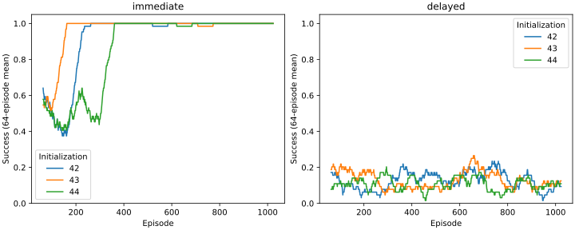

# Learning diagnosis preregistration

**Result: immediate CANARY PASS; delayed canary FAIL; L.1 STILL FAIL.**
Kaggle kernel [ontogeny-learning-diagnosis](https://www.kaggle.com/code/sparklinghydraulics0/ontogeny-learning-diagnosis),
version 1, COMPLETE. Execution source c09f0cb5e1d6fb5a050a977020d9b65f06580ed0.
Upstream 8567836fb2c8c915d442b7c2fbedb4fd9b30396d. Torch 2.6.0+cu124, CUDA 12.4,
Tesla T4; 155.434 s execution excluding setup. No original sealed rollout occurred.
No repair/navigation qualification was admitted after the delayed prerequisite failed.

## Diagnosis and limits of attribution

The neural learner CAN acquire a directly observed cue/action association through its
own sampled actions and consequences. The positive-advantage test passes: log p(action 5)
rises from -1.95922446 to -1.81231749 after one actual AdamW step. Every intended backbone
and head parameter tensor receives a finite gradient and changes; optimizer membership
has no missing, duplicate or stale parameters. This rejects a universal sign reversal,
disconnected head or wholly nonfunctional optimizer explanation for this experiment.
It does not prove every historical update was useful.

Failure appears before full navigation: the same neural configuration does not reliably
learn the three-action cue/stage sequence under the fixed budget. That task changes both
reward delay and stage-conditioned action binding, so it DOES NOT isolate delayed credit
as the sole cause. Distinguishing credit variance, cue/stage representation and their
interaction requires a future matched task with identical mappings and only reward timing
changed. No new task or budget was chosen after inspecting these outcomes.

Original CellWorld has three established limitations/observations: a telescoping reward,
sparse positive feedback, and globally biased action distributions. All 768 training
episodes exhausted energy and had undiscounted return -2.66666667, independently of
collection count. Gamma .97 differentiates discounted trajectories; the reward is not
literally devoid of signal. History persists for learning but is not forward input;
this is a limitation, not evidence that adding memory would solve the failures.

## Original per-initialization evidence

First/last 64 original TRAINING episodes; no new original-world evaluation:

| Init | Resources early → late | Interact when on resource | All-action interaction rate | Positive feedback | Interpretation |
|---|---|---|---|---|---|
| 42 | 40 → 47 | 40/231 → 47/174 (17.3% → 27.0%) | 16.0% → 25.9% | 1.80% → 2.05% | Greater interaction/rest bias; conditioning beyond global frequency unqualified. |
| 43 | 26 → 38 | 26/189 → 38/71 (13.8% → 53.5%) | 15.3% → 63.6% | 1.25% → 1.53% | Frequent interaction including empty locations; cannot infer resource recognition from collection alone. |
| 44 | 35 → 17 | 35/205 → 17/288 (17.1% → 5.9%) | 18.7% → 5.0% | 1.54% → 0.92% | Misses more visible resource opportunities; movement/inspection bias replaces interaction. |

Seed 44 late hazard encounters rise 118 → 129 despite fewer interactions (2,270 →
1,850); inspections rise 205 → 269. Less replenishment and greater hazard/inspection
cost explain earlier depletion in the simulator ledger. This explains the behavioral
regression, not the unique neural cause of that changed action bias. Historical held-out
duration differences versus its frozen initialization were -0.5 default and -1.875 hazard
shift; these are previously reported consumed results, not a new test or tuning signal.

Initial/final endpoint probes use the SAME 256 recorded TRAINING observations per init:

| Init | Initial entropy | Final entropy (nats) | Final effective actions | Notable mean preference |
|---|---:|---:|---:|---|
| 42 | 1.946 | 1.617 | 5.04 | Rest 41.6%, interact 22.4% |
| 43 | 1.946 | 0.418 | 1.52 | Interact 91.5% |
| 44 | 1.945 | 1.494 | 4.45 | Inspect 26.5%, south 21.5%, north 20.1%, interact 8.3% |

Seed 43 shows a strong low-entropy endpoint bias. Seed 44 is not a single-action
collapse; its useful interaction preference is suppressed. These probes are not
historical per-update entropy or uncertainty intervals. All 31 parameter tensors changed
in each original student and have optimizer state; no particular changed tensor is
claimed useful without behavioral ablation. Historical probabilities/advantages cannot
be recovered from the recorded actions alone (RD-002).

## Canary results

Same backbone/head configuration (118,023 parameters), no added trainable capacity.
Each row has 1,024 learning episodes and 512 paired held-out worlds PER control arm.
Evaluation samples the policy; no argmax/heuristic substitution. Random and frozen
controls are initialized independently of feedback. Complete final checkpoints reload
for evaluation, and evaluation leaves weights/update counters unchanged.

| Task | Init | Training success first → last quarter | Held-out learned | Frozen | Random | Gate |
|---|---:|---|---:|---:|---:|---|
| Immediate | 42 | 66.4% → 100% | 100% | 51.8% | 51.8% | PASS |
| Immediate | 43 | 80.9% → 100% | 100% | 51.4% | 51.8% | PASS |
| Immediate | 44 | 50.0% → 100% | 100% | 51.8% | 51.8% | PASS |
| Delayed | 42 | 9.4% → 9.4% | 15.2% | 15.2% | 15.2% | FAIL |
| Delayed | 43 | 16.8% → 10.5% | 15.6% | 14.8% | 15.2% | FAIL |
| Delayed | 44 | 10.9% → 10.5% | 18.9% | 15.6% | 15.2% | FAIL |

Immediate paired lower95 improvement bounds exceed .439 over frozen/random in every
initialization. Delayed bounds fail the preregistered .15 margin in every initialization.
Nominal independent random sequence success is 1/8; the actual fixed paired cohort gives
15.2%. Do not replace measured controls with the nominal probability. Immediate learned
mean cumulative return is +1. Delayed learned returns are -0.6953, -0.6875, -0.6211;
random -0.6953. Full per-seed returns, conditional intervals and entropy: results JSON.

Delayed final evaluation entropy is .6905/.6931/.6145 nats (binary maximum .6931),
with nonzero late gradient norms. Delayed failure is not a universal loss of exploration
or absence of gradients. Immediate final entropy is near zero because the correct
cue association is acquired; low entropy itself is not evidence of a defective collapse.



## Evidence, accounting and stage decision

Non-neural audit PASS: returns, EMA baselines, advantages and losses reconstruct from
logged sampled probabilities, finite gradient norms, all arm/seed coverage and checkpoint
hashes. 6,144 canary optimizer updates plus one controlled sign test; 12,288 training and
18,432 evaluation interactions, 9,216 evaluation episodes. Original endpoint probes add
1,536 seven-action forwards; controlled sign test uses three forwards and one backward.
Training update forwards/backwards are additional to sampled-action inference. No
compute-matching claim against frozen/random controls. The canaries have no energy or
hazards: success/resource event and signed return replace navigation viability metrics.
Original training energy/hazards remain preserved; canaries do not qualify survival.

Every task/init keeps one persistent LearningState across its 1,024 episodes. Separate
tasks are explicitly fresh lineages, not purported transfer from the original learned
cell or from the other canary. Parent checkpoint hashes and experience/world/RNG/baseline/
optimizer/update history persist. Reload for evaluation is verified; a new fresh-process
next-update equivalence test for CueWorld was NOT run. Historical L.1 H3 stays PASS, but
it is not automatically extended to this new environment/state type. No new CellWorld
H1/H2 or continuation qualification is claimed.

Preregistration budget and gates were unchanged. **One controlled original-world repair:
NOT ADMITTED. Independent original-world qualification: NOT RUN.** Delayed failure stops
navigation under this protocol. Next research should isolate reward timing from stage
binding on matched small tasks before proposing a CellWorld intervention. Do not add
capacity/cells or tune on the old sealed cohort. L.1 remains FAIL; only the immediate
canary is qualified here.

Raw files: runs/learning-diagnosis/output/learning-diagnosis, including all distributions,
actions, gradients, advantages, checkpoints and original endpoint predictions. Small
summaries, audit hashes and curves: experiments/learning_diagnosis/results. Original
checkpoint/input hashes verified before loading; no source/model replacement. Core runtime
versions are pinned/captured; complete interpreter/package inventory was not separately
captured for this job, a provenance limitation. Source revisions and launch script remain
sufficient to identify this exact run; no cross-runtime determinism claim.

```bash
# From the final report checkout, pin the published execution source.
uv sync --locked
uv run python scripts/prepare_diagnosis.py --revision c09f0cb5e1d6fb5a050a977020d9b65f06580ed0 --job runs/reproduce-diagnosis/job
kaggle kernels push -p runs/reproduce-diagnosis/job --accelerator NvidiaTeslaT4 -t 1800
kaggle kernels output sparklinghydraulics0/ontogeny-learning-diagnosis/1 -p runs/learning-diagnosis/output
# Alternatively retrieve the literal pinned original job; never substitute current HEAD.
kaggle kernels pull sparklinghydraulics0/ontogeny-learning-diagnosis/1 -p runs/reproduce-diagnosis -m
# From final report checkout, non-neural analysis only:
uv run python scripts/audit_canaries.py runs/learning-diagnosis/output/learning-diagnosis runs/new-canary-audit.json
uv run --with matplotlib==3.10.1 python scripts/report_diagnosis.py runs/learning-diagnosis/output/learning-diagnosis runs/new-diagnosis-report
```

One result download hit transient DNS failure and succeeded on retry. Plot dependency
cache was absent; offline rendering failed before analysis and succeeded after installing
pinned matplotlib. These setup failures did not alter model training or gates. Curves
were rendered and visually inspected. No failed neural result was discarded.

## Original preregistration (unchanged)


Starting tested source ceb52450a3d6fcb074d14ccdae5028b68117ce68; existing uncommitted
style guidance retained and committed separately before executable changes. Historical
policy code, World and consumed sealed benchmark remain unchanged. Upstream exact pin:
8567836fb2c8c915d442b7c2fbedb4fd9b30396d, imported paths verified remotely.

## Confirmed observations before new training

Input is 29 tokens of current local tiles, energy, radius, recent consequence and
readout marker. No observation history, recurrent state or earlier coordinates enter
forward(). Optimizer/experience persistence is not policy context memory. Immediate
resource presence is observable at the center; history is not required to choose
interaction there. Broader navigation may need history; its causal importance is untested.
All seven actions legal; softmax sampling uses owned Python RNG, including evaluation.
No greedy evaluation or privileged wall/resource action mask is used.

Loss is minus selected log-probability times discounted actual energy_delta/15 minus
timestep EMA baseline. Gamma .97, baseline .9 decay, lr .0005, clipping 1. Baseline
updates after gradient. Code sign is conventional; controlled real neural sign/ownership
tests remain required. Mean per-episode loss weights variable episode lengths; it is
not automatically evidence of an implementation defect.

Energy-change reward telescopes: any exhaustion episode's undiscounted return is
-40/15 regardless of resource count. This is a confirmed objective degeneracy; gamma
makes discounted trajectories distinguishable, so it is not proof of unique failure
cause. Training action records are available; historical probabilities, entropy and
advantages were NOT recorded. Initial/final checkpoint measurements are endpoint
probes on original TRAINING observations only, not reconstructed historical quantities.
Parameter changes and moments show updates, not useful representational acquisition.

## Frozen diagnostic sequence and budget

One Kaggle T4 job, pinned Torch 2.6.0+cu124 / NumPy 2.1.3. Maximum 1,200 seconds
execution, 1,800 seconds platform cap including setup. No sealed-world files read,
no original sealed rollout, no capacity change or new neural architecture. Read only
hash-verified original initial/final checkpoints and training interaction history.
Probe up to 256 training observations per initialization with initial/final seven-action
probabilities/entropy; record named parameter differences and optimizer membership.
Controlled positive-advantage test uses fresh matching model, seven-action distribution,
selected action 5 and a single actual AdamW update; selected log probability must rise.
Fail on nonfinite values or optimizer ownership mismatch before canaries.

Canaries use actual MiniGPT and the SAME PolicyNetwork (118,023 parameters), same
AdamW lr, baseline, clipping and discounted policy-gradient objective. Only legal
action logits 0/1 are normalized in two-action tasks; other five head rows remain unused.
This task-interface mask adds no head/capacity and supplies no correct action label.
Fresh initialization declared; no claim of historical learned knowledge continuity.
One persistent owner per task/initialization across all its training episodes.

Immediate cue: seeded binary cue is resource/hazard center tile in the existing
observation encoder. Actions 0/1 have terminal rewards +1/-1 based on hidden cue rule;
policy samples its own actions and receives ONLY consequences. No teacher action.
Delayed cue: 3 actions, no intermediate reward, terminal +/-1 for a cue-conditioned
alternating sequence. Current cue and stage (recent-consequence token) are observable;
no oracle success flag until terminal. This isolates simple delayed credit with sufficient
sensory state, not memory or navigation. Separate diagnostic worlds; CellWorld unchanged.

Each task: initializations 42/43/44, 1,024 training episodes on seeds 70000..71023;
512 held-out evaluation episodes on 80000..80511 per arm. Paired frozen/random/trained
controls, identical per-evaluation action RNG. Frozen checkpoints immutable; no eval
updates or parameter changes permitted. Record every distribution, action, return,
advantage, gradient norm, feedback, owner experience/world/RNG and initial/final checkpoints.
Same limits for delayed task; at most 6,144 canary updates plus one sign-test update.
No search, favorable checkpoint selection or extra seeds.

Per-initialization canary PASS requires >=90% held-out success, last training quarter
success > first quarter by .1, and paired conditional-on-initialization 95% normal
interval lower bound >.15 over BOTH random/frozen (512 paired worlds). Task PASS needs
all three initializations. These canary intervals do not establish CellWorld transfer.
If immediate FAIL: stop, no delayed canary, no navigation repair. If delayed FAIL:
stop before navigation; diagnose credit/representation rather than hide it with curriculum.
If both PASS: CANARY PASS, L.1 STILL FAIL; any original-world intervention needs a new
preregistered controlled protocol justified by these diagnostics, not consumed sealed data.
This job never executes an original-world repair. No L.2 or second cell.
